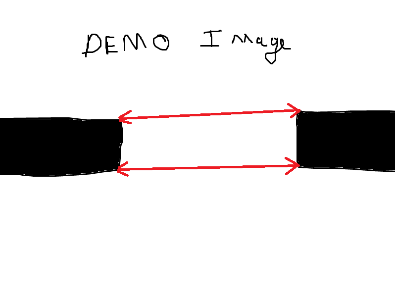
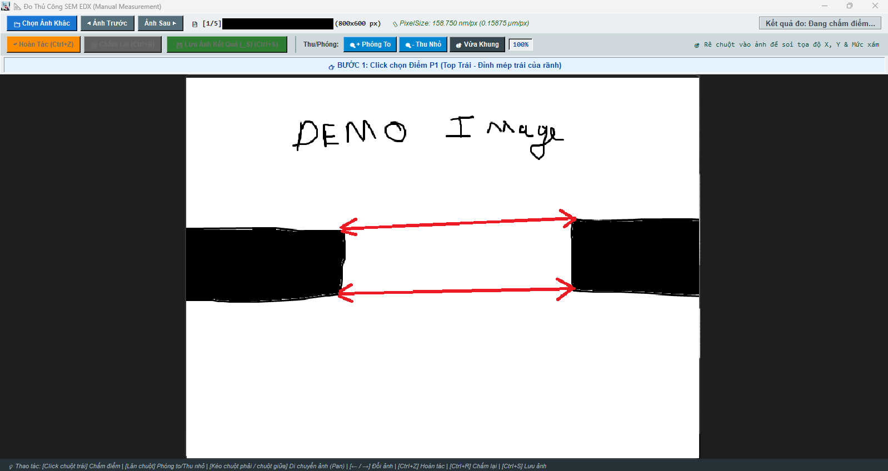

# AUTO MEASUREMENT FOR SEM EDX
### Hệ Thống Thị Giác Máy Tính Đo Tự Động Kích Thước Đường Kính Lỗ (SEM Metrology)

---

## 📌 1. TỔNG QUAN DỰ ÁN (PROJECT OVERVIEW)

**Auto Measurement For SEM EDX** là giải pháp phần mềm thị giác máy tính công nghiệp chuyên dụng được thiết kế nhằm tự động hóa 100% quy trình đo đạc kích thước các vi cấu trúc (rãnh cắt, via, khe hở vi cơ điện tử) trên ảnh chụp kính hiển vi điện tử quét (**Scanning Electron Microscope - SEM**) kèm đầu dò tán sắc năng lượng tia X (**EDX**).

Phần mềm giải quyết triệt để bài toán thắt cổ chai trong quy trình QA/QC sản xuất linh kiện bán dẫn: **thay thế hoàn toàn thao tác căn mắt đo thủ công từng ảnh của kỹ thuật viên**, triệt tiêu sai số chủ quan, tăng tốc độ xử lý gấp hơn **30 lần** và tự động hóa toàn diện khâu lập báo cáo nghiệm thu Excel theo tiêu chuẩn nhà máy.

### 🎯 Phương Pháp Tiếp Cận Đột Phá: Thị Giác Máy Tính Thuần Túy (Không Dùng AI/Deep Learning)
Khác với các phương pháp tiếp cận theo xu hướng dùng mạng nơ-ron học sâu (Deep Learning) vốn tiềm ẩn hiện tượng **ảo giác (hallucination)**, không thể giải trình cơ chế toán học và đòi hỏi cấu hình GPU đắt đỏ, **Auto Measurement For SEM EDX** được xây dựng trên nền tảng **Thị giác máy tính hình học tất định (Deterministic & Geometric Computer Vision)**:
- **Tính tất định 100% (Deterministic):** Cùng một bức ảnh đầu vào sẽ luôn cho ra duy nhất một kết quả đo chính xác đến từng pixel, không phụ thuộc vào trọng số ngẫu nhiên hay suy diễn xác suất.
- **Tốc độ xử lý cực hạn:** Thời gian tính toán cho mỗi bức ảnh chỉ mất **$< 0.2$ giây**, cho phép xử lý toàn bộ lô hàng hàng chục ảnh trong vài giây.
- **Tiết kiệm chi phí vận hành:** Hoạt động mượt mà trên bất kỳ máy tính văn phòng/CPU thông thường nào tại phân xưởng mà không cần trang bị card đồ họa rời GPU.
- **Độ tin cậy kiểm định (Explainability):** Mọi quyết định xác định điểm đo đều dựa trên công thức toán học và quy tắc hình học rõ ràng, đáp ứng các tiêu chuẩn thẩm định hệ thống đo lường khắt khe nhất (**Measurement System Analysis - MSA**).

---

## 📸 2. MINH CHỨNG TRỰC QUAN TỪ DỰ ÁN

Hệ thống được trực quan hóa thông qua 2 thành phần cốt lõi:

| ⭐ LÕI ĐO TỰ ĐỘNG 100% (Example.png) | 🛠️ CÔNG CỤ ĐO THỦ CÔNG PHỤ TRỢ (Demo Đo thủ công.png) |
| :---: | :---: |
|  |  |
| *Mô hình thuật toán Đo Tự Động 100%: Tự phát hiện vách, tự bắt 4 điểm $P_1, P_2, P_3, P_4$, tự vẽ đường đo Top/Bot và tính %Taper chỉ trong vài mili-giây.* | *Mô-đun phụ trợ đi kèm: Hỗ trợ kỹ thuật viên và kiểm toán QA/QC zoom 20%-2000%, pan mượt mà >200 FPS và chấm điểm thẩm định lại khi gặp mẫu ảnh dị biệt.* |

---

## ⚙️ 3. CÁC TÍNH NĂNG KỸ THUẬT NỔI BẬT

### 1. Thuật Toán Lọc Không Gian 3 Lớp Bắt Chính Xác 4 Điểm Pixel Góc Biên
Để xác định chính xác 4 điểm mép trong của khe rãnh:
- $P_1$ (Top-Left): Góc đỉnh mép trong vách Trái.
- $P_2$ (Top-Right): Góc đỉnh mép trong vách Phải.
- $P_3$ (Bottom-Left): Góc đáy mép trong vách Trái.
- $P_4$ (Bottom-Right): Góc đáy mép trong vách Phải.

Hệ thống áp dụng thuật toán hình học 3 tầng liên hoàn:
- **Lớp 1 - Tìm Hạt Giống (Seed Point) Bằng Điểm Số Định Hướng & Cửa Sổ Mật Độ $30 \times 30$:** Giới hạn dải tìm kiếm $120\text{ px}$, sử dụng hàm chấm điểm định hướng đa chiều ($Score = \pm(w_x X \pm w_y Y)$ với $w_x=1.0, w_y=1.5$). Cửa sổ mật độ $30 \times 30\text{ px}$ bắt buộc tỷ lệ vật chất đặc $\ge 20\%$ giúp loại trừ hoàn toàn các chấm bụi trôi nổi.
- **Lớp 2 - Dò Lân Cận $360^\circ$ & Khóa Trục Ngang X ($\pm 25\text{ px}$):** Dò tìm điểm cực trị mép gờ nhô ra ngoài cùng nhất, kết hợp kiểm tra 8-láng giềng liền kề ($3 \times 3 \ge 3$ pixel vật chất) triệt tiêu gai nhọn và cơ chế khóa trục $X$ chống trượt điểm xuống sườn rãnh dốc.
- **Lớp 3 - Cân Bằng Đồng Phẳng Trục Y & Khóa Góc Lệch Tối Đa $35^\circ$:** Theo tiêu chuẩn vi điện tử, mặt cắt ngang luôn có tính đồng phẳng. Nếu góc nghiêng đường đo $\theta > 35^\circ$ hoặc chênh lệch $\Delta Y > 60\text{ px}$ do khuyết tật vật liệu, hệ thống tự động kích hoạt cơ chế Force gióng ngang (`find_x_at_y`), lấy điểm chuẩn trên kéo điểm lệch về đúng mặt cắt chuẩn ngang.

### 2. Trích Xuất Tỷ Lệ Vật Lý Thực Tế Từ Phần Cứng
- Tự động phân tích file cấu hình phần cứng `.txt` đi kèm ảnh SEM (hỗ trợ đa bảng mã: `utf-8`, `utf-16le`, `cp1252`).
- Trích xuất trường dữ liệu `PixelSize` tính bằng nanomet ($nm$).
- Tự động quy đổi sang tỷ lệ chuẩn micromet trên pixel:
  $$\text{Ratio} = \frac{\text{PixelSize}}{1000.0} \quad (\mu m/\text{pixel})$$
  Đảm bảo độ chính xác tuyệt đối theo từng mức phóng đại của ống kính SEM mà không cần nhập thủ công.

### 3. Cơ Chế Khử Nhiễu Vật Lý & Bảo Vệ Hình Học
- **Quy tắc chia trục Y làm 4 phần & Loại bỏ vùng chân đế:** Toàn bộ pixel ở khoảng phần 4 cạnh đáy ảnh ($Y \ge 0.75H$) bị loại bỏ $100\%$ kết hợp hàm `filter_bottom_connected_pixels`, triệt tiêu hoàn toàn nguy cơ đo nhầm xuống chân substrate hoặc thanh banner của máy SEM.
- **Lọc vết bẩn cô lập giữa lòng rãnh:** Thuật toán phân tích liên thông đệ quy xóa bỏ các cụm pixel đen bị bao quanh bởi khoảng trắng có khoảng cách Euclidean tới vách vượt quá $12\text{ px}$.
- **Hàn gắn vách nứt gãy (Bridge Dilation):** Quét vùng lân cận bán kính $12\text{ px}$ để bắc cầu kết nối các mảng chóp rãnh bị đứt đoạn do nhị phân hóa về lại khối vách chính liền mép, bắt chính xác mỏm nhô ra ngoài cùng.

### 4. Tự Động Hóa Báo Cáo Excel Phân Bổ 1 Đến 4 Máy
- Tự động bóc tách thông tin lô hàng từ tên thư mục:
  $$\text{<ITEM\_CODE>\_\<LOT>\_\<WORKER\_ID>\_\<MACHINE>\_\<STAGE>}$$
- Nhận diện ký tự `+` trong mã máy để tự động chọn đúng biểu mẫu báo cáo (`Form(1May)`, `Form(2May)`, `Form(3May)`, `Form(4May)`).
- Tự động phân bổ đúng dòng, điền giá trị Top ($\mu m$), Bot ($\mu m$) và thiết lập sẵn công thức Excel `=H{row}/G{row}*100` để tính `%Taper` tự động.
- Lưu trữ kết quả đo chuẩn hóa vào thư mục `Ket qua` phục vụ lưu trữ và kiểm toán chất lượng.

### 5. Công Cụ Đo Thủ Công (Manual Inspection Suite) Với Zoom & Pan 2000%
- Bộ điều khiển đặt gọn gàng ở thanh công cụ phía trên (**Top Toolbar**), giải phóng $100\%$ không gian canvas cho việc quan sát ảnh vi cấu trúc.
- Hỗ trợ phóng to từ $20\%$ đến $2000\%$ bằng con lăn chuột, kéo di chuyển ảnh (Pan) bằng chuột phải hoặc chuột giữa.
- Thuật toán tối ưu hóa render ROI đạt tốc độ phản hồi cực nhanh **$> 200$ FPS**, thao tác mượt mà không độ trễ.
- **Pixel Inspector:** Rê chuột để soi tọa độ $(X, Y)$, mức xám Grayscale ($0 - 255$) và mã màu RGB tức thời.
- **Step Guide Banner:** Hướng dẫn 4 bước trực quan kèm hàm `sort_4_points` tự động phân loại thông minh 4 điểm dù người dùng chấm theo bất kỳ thứ tự nào.
- Đồng bộ phím tắt công nghiệp: `Ctrl+Z` (Hoàn tác), `Ctrl+R` (Chấm lại), `Ctrl+S` (Lưu ảnh `_S.bmp` và tự động cập nhật lại dòng dữ liệu trong file Excel của lô hàng).

### 6. Cửa Sổ Debug & Phân Tích Độ Nhạy Ngưỡng (Dual Preview & JSON Pair Export)
- Thanh điều chỉnh Threshold linh hoạt từ $10$ đến $240$ (chuẩn mặc định $120$) kèm khả năng lưu nhớ ngưỡng độc lập cho từng ảnh trong thư mục.
- Hiển thị song song thời gian thực (**Dual Preview**): Ảnh nhị phân (Binary Mask) và Ảnh đo đạc thực tế kèm đường kích thước.
- Xuất cặp file JSON chuyên sâu: `<Tên_Ảnh>_original.json` và `<Tên_Ảnh>_adjusted.json` phục vụ phân tích histogram, tìm điểm trũng phân tách bimodal valley và bảng phân tích độ nhạy (Sensitivity Analysis Sweep).

---

## 🧮 4. CÔNG THỨC TOÁN HỌC & ĐO ĐẠC ĐẦU RA

Sau khi thuật toán hội tụ và xác định được 4 tọa độ pixel chính xác:
- $P_1 = (x_1, y_1)$ &mdash; Đỉnh mép trái
- $P_2 = (x_2, y_2)$ &mdash; Đỉnh mép phải
- $P_3 = (x_3, y_3)$ &mdash; Đáy mép trái
- $P_4 = (x_4, y_4)$ &mdash; Đáy mép phải

### 1. Khoảng cách hình học Euclidean (pixel):
$$\text{dist\_top\_px} = \sqrt{(x_2 - x_1)^2 + (y_2 - y_1)^2}$$
$$\text{dist\_bot\_px} = \sqrt{(x_4 - x_3)^2 + (y_4 - y_3)^2}$$

### 2. Kích thước thực tế theo đơn vị micromet ($\mu m$):
$$\text{Top} = \text{dist\_top\_px} \times \left(\frac{\text{PixelSize}}{1000.0}\right) \quad (\mu m)$$
$$\text{Bot} = \text{dist\_bot\_px} \times \left(\frac{\text{PixelSize}}{1000.0}\right) \quad (\mu m)$$

### 3. Tỷ lệ độ thuôn / độ vát (%Taper):
$$\%\text{Taper} = \left(\frac{\text{Bot}}{\text{Top}}\right) \times 100\%$$

---

## 📊 5. BẢNG SO SÁNH ĐỘ TIN CẬY & GIẢI TRÌNH KỸ THUẬT (MSA DEFENSE)

| Yếu tố rủi ro trong đo SEM | Cơ chế giải quyết của phần mềm | Kết quả kỹ thuật đạt được |
| :--- | :--- | :--- |
| **Sai lệch tỷ lệ phóng đại** | Đọc trực tiếp thẻ `PixelSize` từ file cấu hình phần cứng `.txt` | Độ chính xác tỷ lệ nm/px đạt $100\%$, độc lập với thao tác người dùng. |
| **Đo nhầm xuống lớp Substrate** | Hàm `filter_bottom_connected_pixels` + Khóa vùng đáy $Y \ge 0.75H$ | Ngăn chặn triệt để nguy cơ bắt nhầm điểm đo xuống chân đế hay thanh chữ. |
| **Đo lệch góc, xiên chéo xuống dưới** | Khóa góc nghiêng tối đa $35^\circ$ kết hợp gióng ngang theo điểm chuẩn trên | Đường đo luôn giữ phương nằm ngang chuẩn mặt cắt vi cấu trúc. |
| **Bụi bẩn trôi nổi giữa lòng rãnh** | Cửa sổ mật độ $30 \times 30$ yêu cầu độ đặc vật chất $\ge 20\%$ | Lọc sạch các đốm nhiễu li ti, không bắt nhầm góc vào hạt bụi. |
| **Mép vách bị nứt gãy / đứt đoạn** | Thuật toán quét bán kính $12\text{ px}$ tạo cầu nối liên thông về vách chính | Tái tạo vách hoàn chỉnh, bắt đúng pixel nhô ra ngoài cùng nhất. |
| **Thời gian đo & Lỗi con người** | Thuật toán tự động hóa hoàn toàn với 32 luồng song song | Giảm thời gian từ 3-5 phút/ảnh xuống **$<0.2$ giây/ảnh**, lỗi nhập liệu Excel bằng $0\%$. |

---

## 🛠️ 6. CÔNG NGHỆ SỬ DỤNG (TECH STACK)

- **Ngôn ngữ:** Python 3.10+
- **Thị giác máy tính & Xử lý ảnh:** OpenCV (`opencv-python` / `cv2`), NumPy Vectorization
- **Xử lý bảng tính & Tự động hóa Excel:** `openpyxl`
- **Giao diện người dùng (GUI):** Tkinter, Pillow (`PIL`), Canvas Custom Rendering
- **Xử lý song song:** `concurrent.futures.ThreadPoolExecutor` (32 workers)
- **Kiến trúc phần mềm:** Modular Architecture, Non-destructive Image Processing, Unicode/Vietnamese Path Safe

---

